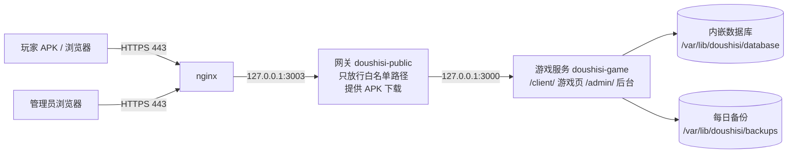

# 部署到新服务器

照测试服 108 已经跑通的做法，把斗十四装到一台全新的 Linux 服务器上，从 GitHub 拉代码。所有命令都在服务器上用 root 执行，除非另外说明。

## 整体结构



| 位置 | 放什么 |
| --- | --- |
| `/opt/doushisi/runtime` | Node 24 和 pnpm |
| `/opt/doushisi/app` | 从 GitHub 拉下来的代码，在这里构建、运行 |
| `/opt/doushisi/gateway/game-proxy.cjs` | 网关 |
| `/opt/doushisi/certbot` | 申请 HTTPS 证书的 certbot |
| `/var/lib/doushisi/database` | 数据库（内嵌 PGlite，不用另装 PostgreSQL） |
| `/var/lib/doushisi/backups` | 每天自动备份，留最近 14 份 |
| `/var/lib/doushisi/downloads/doushisi.apk` | 下载页的安装包 |

游戏服务和网关都以系统用户 `doushisi` 运行，只能写 `/var/lib/doushisi`。

## 0. 准备

- **服务器**：Ubuntu 22.04 / 24.04 或 Debian 12，x86_64，至少 2 核 4G 内存、20G 硬盘。内存只有 2G 时先加 2G 交换分区，否则构建时可能被杀。
- **地址**：推荐用域名，先把域名的 A 记录解析到服务器公网 IP。没有域名也可以只用 IP，证书换成 IP 证书（第 5 步有写）。
- **端口**：云服务商的安全组和服务器防火墙放行 22、80、443。3000、3003 只在本机用，不要对外开。

下面的命令里 `SITE` 指你的域名或 IP。每次新开 SSH 窗口先设一次：

```bash
SITE=game.example.com
```

## 1. 装基础软件、Node 24、pnpm

```bash
export DEBIAN_FRONTEND=noninteractive
apt-get update
apt-get install -y --no-install-recommends nginx git curl ca-certificates xz-utils python3-venv
install -d -m 755 /opt/doushisi /opt/doushisi/runtime /opt/doushisi/gateway /var/www/doushisi-acme

cd /opt/doushisi/runtime
curl -fsSL https://nodejs.org/dist/index.json -o node-index.json
version=$(python3 -c 'import json; print(next(x["version"] for x in json.load(open("node-index.json")) if x["version"].startswith("v24.") and x["lts"]))')
name="node-$version-linux-x64.tar.xz"
curl -fsSL "https://nodejs.org/dist/$version/$name" -o "$name"
curl -fsSL "https://nodejs.org/dist/$version/SHASUMS256.txt" -o SHASUMS256.txt
grep " $name$" SHASUMS256.txt | sha256sum -c -
tar -xJf "$name" --strip-components=1
export PATH=/opt/doushisi/runtime/bin:$PATH
npm install --global --prefix /opt/doushisi/runtime pnpm@11.19.0
node -v && pnpm -v
```

以后每次登录要用 node、pnpm，先执行 `export PATH=/opt/doushisi/runtime/bin:$PATH`。

建运行用户和数据目录：

```bash
id doushisi >/dev/null 2>&1 || useradd --system --home /var/lib/doushisi --shell /usr/sbin/nologin doushisi
install -d -o doushisi -g doushisi -m 700 /var/lib/doushisi /var/lib/doushisi/backups /var/lib/doushisi/downloads
```

## 2. 拉代码、构建

```bash
export PATH=/opt/doushisi/runtime/bin:$PATH
git clone https://github.com/yuanjialu1111-gif/doushisi.git /opt/doushisi/app
cd /opt/doushisi/app
pnpm install --frozen-lockfile
pnpm build
chmod -R a+rX /opt/doushisi/app
ls apps/server/dist/main.js apps/admin/dist/index.html
```

最后一行两个文件都列出来就是构建成功。构建会改动 `verification/build-manifest.json`，这是正常的。

## 3. 网关

网关只把玩家和后台用得到的路径转给游戏服务，别的一律 404，同时提供 `/doushisi.apk` 下载。把下面整段贴进终端，生成 `/opt/doushisi/gateway/game-proxy.cjs`：

```bash
cat > /opt/doushisi/gateway/game-proxy.cjs <<'JS'
const http = require('node:http');
const fs = require('node:fs');
const path = require('node:path');
const { createRequire } = require('node:module');
const root = '/opt/doushisi/app';
const { WebSocket, WebSocketServer } = createRequire(path.join(root, 'apps/server/package.json'))('ws');
const upstream = 'http://127.0.0.1:3000';
const apk = process.env.DOUSHISI_DOWNLOAD_APK || '/var/lib/doushisi/downloads/doushisi.apk';
function allowed(raw, upgrade = false) {
  let pathname;
  try { pathname = decodeURIComponent(raw.split('?')[0]); } catch { return false; }
  if (pathname.includes('\\') || pathname.includes('%') ||
      pathname.split('/').some(p => p === '.' || p === '..')) return false;
  if (upgrade) return ['/ws/original', '/api/live'].includes(pathname);
  return pathname === '/health' || pathname.startsWith('/client/') ||
    /^\/api\/auth\/(register|login|logout)$/.test(pathname) ||
    pathname.startsWith('/admin/') || pathname.startsWith('/api/admin/') ||
    /^\/api\/(me|games|friends|records|rooms|lobby)(\/|$)/.test(pathname) ||
    pathname.startsWith('/media/avatars/');
}
const server = http.createServer((req, res) => {
  if (req.url === '/') {
    res.writeHead(302, { Location: '/client/' }); res.end(); return;
  }
  if (req.url === '/doushisi.apk' && ['GET', 'HEAD'].includes(req.method)) {
    fs.stat(apk, (error, stat) => {
      if (error) { res.writeHead(503); res.end('APK not ready'); return; }
      let start = 0, end = stat.size - 1, status = 200;
      const headers = { 'Content-Type': 'application/vnd.android.package-archive',
        'Content-Disposition': 'attachment; filename="doushisi.apk"',
        'Cache-Control': 'no-store', 'Accept-Ranges': 'bytes' };
      if (req.headers.range) {
        const match = /^bytes=(\d+)-(\d*)$/.exec(req.headers.range);
        if (!match || !Number.isSafeInteger(+match[1]) || +match[1] >= stat.size ||
            match[2] && (!Number.isSafeInteger(+match[2]) || +match[2] < +match[1])) {
          res.writeHead(416, { 'Content-Range': 'bytes */' + stat.size }); res.end(); return;
        }
        start = +match[1]; end = match[2] ? Math.min(+match[2], end) : end; status = 206;
        headers['Content-Range'] = `bytes ${start}-${end}/${stat.size}`;
      }
      headers['Content-Length'] = end - start + 1;
      res.writeHead(status, headers);
      if (req.method === 'HEAD') { res.end(); return; }
      const stream = fs.createReadStream(apk, { start, end });
      stream.on('error', () => res.destroy());
      res.on('close', () => stream.destroy());
      stream.pipe(res);
    });
    return;
  }
  if (!allowed(req.url)) { res.writeHead(404); res.end(); return; }
  const headers = { ...req.headers, host: '127.0.0.1:3000' };
  for (const key of Object.keys(headers)) {
    if (/^(forwarded|x-forwarded-|cf-)/i.test(key)) delete headers[key];
  }
  const proxy = http.request(upstream + req.url, { method: req.method, headers }, response => {
    res.writeHead(response.statusCode, response.headers);
    response.pipe(res);
  });
  proxy.on('error', () => { if (!res.headersSent) res.writeHead(502); res.end(); });
  req.on('aborted', () => proxy.destroy());
  req.pipe(proxy);
});
const wss = new WebSocketServer({ noServer: true, maxPayload: 1024 * 1024 });
server.on('upgrade', (req, socket, head) => {
  if (!allowed(req.url, true)) { socket.end('HTTP/1.1 404 Not Found\r\n\r\n'); return; }
  const remote = new WebSocket(upstream.replace('http:', 'ws:') + req.url, { maxPayload: 1024 * 1024 });
  socket.on('close', () => remote.close());
  remote.once('error', () => socket.destroy());
  remote.once('open', () => wss.handleUpgrade(req, socket, head, client => {
    client.on('message', (data, binary) => { if (remote.readyState === WebSocket.OPEN) remote.send(data, { binary }); });
    remote.on('message', (data, binary) => { if (client.readyState === WebSocket.OPEN) client.send(data, { binary }); });
    client.on('close', () => remote.close());
    remote.on('close', () => client.close());
    client.on('error', () => remote.close());
    remote.on('error', () => client.close());
  }));
});
server.listen(3003, '127.0.0.1', () => console.log('Gateway: http://127.0.0.1:3003'));
JS
/opt/doushisi/runtime/bin/node --check /opt/doushisi/gateway/game-proxy.cjs && chmod 644 /opt/doushisi/gateway/game-proxy.cjs
```

## 4. 两个服务

游戏服务用内嵌数据库，所以 `NODE_ENV` 必须是 `development`。设成 `production` 会要求外接 PostgreSQL，服务起不来。不要设 `DSS_TEST_DEALS`，那是本机测试台专用。

数据库运行时会留一个占用标记 `/var/lib/doushisi/database.owner-lock`。服务被强杀或服务器断电后，这个标记还在，下次启动会报 `LOCAL_DATABASE_STALE_LOCK`。下面先放一个启动前清理脚本：确认留标记的进程已经不在了才删，进程还活着就拒绝启动。

```bash
cat > /opt/doushisi/clean-owner-lock.mjs <<'JS'
import { readFile, unlink } from 'node:fs/promises';

const path = '/var/lib/doushisi/database.owner-lock';
try {
  const owner = JSON.parse(await readFile(path, 'utf8'));
  if (!Number.isInteger(owner.pid) || owner.pid <= 0) throw new Error('Invalid owner lock');
  try {
    process.kill(owner.pid, 0);
    throw new Error('Database owner is still alive; startup refused');
  } catch (error) {
    if (error.code !== 'ESRCH') throw error;
  }
  await unlink(path);
  console.log('Removed stale owner lock after verifying process exit.');
} catch (error) {
  if (error.code !== 'ENOENT') throw error;
}
JS
chmod 644 /opt/doushisi/clean-owner-lock.mjs

cat > /etc/systemd/system/doushisi-game.service <<EOF
[Unit]
Description=Doushisi game server
After=network-online.target
Wants=network-online.target

[Service]
Type=simple
User=doushisi
Group=doushisi
WorkingDirectory=/opt/doushisi/app
Environment=NODE_ENV=development
Environment=HOST=127.0.0.1
Environment=PORT=3000
Environment=LOCAL_DATABASE_DIR=/var/lib/doushisi/database
Environment=LOCAL_BACKUP_DIR=/var/lib/doushisi/backups
Environment=ADMIN_ORIGIN=https://${SITE}
ExecStartPre=/opt/doushisi/runtime/bin/node /opt/doushisi/clean-owner-lock.mjs
ExecStart=/opt/doushisi/runtime/bin/node apps/server/dist/main.js
Restart=on-failure
RestartSec=5
TimeoutStopSec=90
NoNewPrivileges=true
PrivateTmp=true
ProtectSystem=strict
ProtectHome=true
ReadWritePaths=/var/lib/doushisi
UMask=0077
LimitNOFILE=8192

[Install]
WantedBy=multi-user.target
EOF

cat > /etc/systemd/system/doushisi-public.service <<'EOF'
[Unit]
Description=Doushisi public gateway
After=doushisi-game.service
Wants=doushisi-game.service

[Service]
Type=simple
User=doushisi
Group=doushisi
WorkingDirectory=/opt/doushisi/gateway
Environment=DOUSHISI_DOWNLOAD_APK=/var/lib/doushisi/downloads/doushisi.apk
ExecStart=/opt/doushisi/runtime/bin/node /opt/doushisi/gateway/game-proxy.cjs
Restart=on-failure
RestartSec=5
NoNewPrivileges=true
PrivateTmp=true
ProtectSystem=strict
ProtectHome=true
UMask=0077

[Install]
WantedBy=multi-user.target
EOF

grep ADMIN_ORIGIN /etc/systemd/system/doushisi-game.service
```

最后一行要显示你的域名或 IP。如果是 `https://` 后面空着，说明没设 `SITE`，设好再贴一遍。

## 5. HTTPS 证书

先让 nginx 只回应证书验证：

```bash
cat > /etc/nginx/conf.d/doushisi-websocket.conf <<'EOF'
map $http_upgrade $doushisi_connection_upgrade {
    default upgrade;
    '' close;
}
EOF
cat > /etc/nginx/sites-available/doushisi <<EOF
server {
    listen 80 default_server;
    server_name ${SITE};
    location ^~ /.well-known/acme-challenge/ { root /var/www/doushisi-acme; default_type text/plain; }
    location / { return 404; }
}
EOF
[ -L /etc/nginx/sites-enabled/default ] && mv /etc/nginx/sites-enabled/default /etc/nginx/default-symlink.before-doushisi
ln -sf /etc/nginx/sites-available/doushisi /etc/nginx/sites-enabled/doushisi
nginx -t && systemctl reload nginx

python3 -m venv /opt/doushisi/certbot
/opt/doushisi/certbot/bin/pip install --quiet --upgrade certbot
```

用域名时：

```bash
/opt/doushisi/certbot/bin/certbot certonly --webroot -w /var/www/doushisi-acme -d "$SITE" \
  --cert-name doushisi --agree-tos --register-unsafely-without-email --non-interactive
```

只有 IP 时（Let's Encrypt 的 IP 证书只有几天有效期，下面的定时续期必须装）：

```bash
/opt/doushisi/certbot/bin/certbot certonly --webroot -w /var/www/doushisi-acme --ip-address "$SITE" \
  --required-profile shortlived --cert-name doushisi --agree-tos --register-unsafely-without-email --non-interactive
```

装定时续期（每小时检查一次，快到期才真的续）：

```bash
cat > /etc/systemd/system/doushisi-cert-renew.service <<'EOF'
[Unit]
Description=Renew Doushisi TLS certificate
After=network-online.target

[Service]
Type=oneshot
ExecStart=/opt/doushisi/certbot/bin/certbot renew --quiet --deploy-hook "/usr/sbin/nginx -t && /usr/bin/systemctl reload nginx"
EOF
cat > /etc/systemd/system/doushisi-cert-renew.timer <<'EOF'
[Unit]
Description=Check Doushisi TLS certificate renewal hourly

[Timer]
OnCalendar=hourly
RandomizedDelaySec=900
Persistent=true

[Install]
WantedBy=timers.target
EOF
```

## 6. 正式的 nginx 配置

全站请求体限 64k，只有头像上传放宽到 6m（客户端已经把头像缩到 512 像素，服务端自己限 5MB）。

```bash
cat > /etc/nginx/sites-available/doushisi <<EOF
server {
    listen 80 default_server;
    server_name ${SITE};
    location ^~ /.well-known/acme-challenge/ { root /var/www/doushisi-acme; default_type text/plain; }
    location / { return 308 https://${SITE}\$request_uri; }
}
server {
    listen 443 ssl default_server;
    server_name ${SITE};
    ssl_certificate /etc/letsencrypt/live/doushisi/fullchain.pem;
    ssl_certificate_key /etc/letsencrypt/live/doushisi/privkey.pem;
    ssl_protocols TLSv1.2 TLSv1.3;
    ssl_session_cache shared:DoushisiTLS:10m;
    server_tokens off;
    client_max_body_size 64k;
    add_header X-Content-Type-Options nosniff always;
    location = /api/me/avatar {
        client_max_body_size 6m;
        proxy_pass http://127.0.0.1:3003;
        proxy_http_version 1.1;
        proxy_set_header Host 127.0.0.1:3003;
        proxy_set_header Connection "";
        proxy_set_header Forwarded "";
        proxy_set_header X-Forwarded-For "";
        proxy_set_header X-Forwarded-Host "";
        proxy_set_header X-Forwarded-Proto "";
        proxy_read_timeout 60s;
        proxy_send_timeout 60s;
    }
    location / {
        proxy_pass http://127.0.0.1:3003;
        proxy_http_version 1.1;
        proxy_set_header Host 127.0.0.1:3003;
        proxy_set_header Upgrade \$http_upgrade;
        proxy_set_header Connection \$doushisi_connection_upgrade;
        proxy_set_header Forwarded "";
        proxy_set_header X-Forwarded-For "";
        proxy_set_header X-Forwarded-Host "";
        proxy_set_header X-Forwarded-Proto "";
        proxy_read_timeout 600s;
        proxy_send_timeout 600s;
        proxy_buffering off;
    }
}
EOF
nginx -t
```

`nginx -t` 显示 `syntax is ok` 和 `test is successful` 才往下走。

## 7. 建后台管理员（只在第一次做）

后台有两种管理员：豆子管理员（`beans_admin`，给玩家加减豆子、看账目）和发牌管理员（`deal_admin`，管发牌策略）。用户名自己定，下面用 `boss` 和 `dealer` 举例。密码会随机生成并打印一次，马上记到密码管理器里，别发到聊天里。

```bash
cd /opt/doushisi/app
runuser -u doushisi -- env LOCAL_DATABASE_DIR=/var/lib/doushisi/database /opt/doushisi/runtime/bin/node apps/server/dist/bootstrap-admin.js beans_admin boss
runuser -u doushisi -- env LOCAL_DATABASE_DIR=/var/lib/doushisi/database /opt/doushisi/runtime/bin/node apps/server/dist/bootstrap-admin.js deal_admin dealer
```

这一步要在游戏服务没运行时做，因为数据库同一时间只能有一个进程打开。第一次运行时它会顺带建库、跑完数据库迁移。

## 8. 启动、自检

```bash
systemctl daemon-reload
systemctl enable --now doushisi-game doushisi-public doushisi-cert-renew.timer
systemctl reload nginx
sleep 10
for item in "健康检查 200 /health" "游戏页 200 /client/" "后台页面 200 /admin/" \
            "大厅接口未登录 401 /api/lobby/tables" "后台接口未登录 401 /api/admin/me" \
            "头像不存在跳默认图 302 /media/avatars/none.jpg"; do
  set -- $item
  code=$(curl -sk -o /dev/null -w '%{http_code}' "https://${SITE}$3")
  [ "$code" = "$2" ] && echo "ok  $1" || echo "!!  $1：期望 $2，实际 $code"
done
```

六行全是 `ok` 就装好了。浏览器打开 `https://你的域名/admin/`，用第 7 步的账号登录。第一次启动时，大厅的系统桌会按默认模板自动建好。

有 `!!` 时看日志：

```bash
journalctl -u doushisi-game -n 100 --no-pager
journalctl -u doushisi-public -n 50 --no-pager
```

## 9. 安装包（在 Mac 上做）

现在的安装包连的是测试服 108，不会连新服务器，要重新打一个写着新地址的包。打包工具、签名钥匙都在 Mac 上；底包是 `线上部署包/doushisi.apk`，没传到 GitHub。用同一把签名钥匙打的包，玩家可以直接覆盖安装。

```bash
node /Users/mac/Documents/Projects/斗十四/tools/android-build.mjs --base /Users/mac/Documents/Projects/斗十四/线上部署包/doushisi.apk --api-base https://game.example.com
```

`--api-base` 换成新服务器的地址。打好后上传到服务器的下载目录，`新包.apk` 换成打包输出的文件路径：

```bash
scp 新包.apk root@game.example.com:/var/lib/doushisi/downloads/doushisi.apk.upload
```

再回到服务器上：

```bash
cd /var/lib/doushisi/downloads
chown doushisi:doushisi doushisi.apk.upload && chmod 600 doushisi.apk.upload
mv doushisi.apk.upload doushisi.apk
curl -skI "https://${SITE}/doushisi.apk" | head -1
```

返回 `200` 后，玩家用 `https://你的域名/doushisi.apk` 下载。

## 日常维护

**更新到 GitHub 上的新版本**（会停服一两分钟，避开有人在打的时候）：

```bash
export PATH=/opt/doushisi/runtime/bin:$PATH
cd /opt/doushisi/app
git checkout -- verification/build-manifest.json
old=$(git rev-parse HEAD)
git pull --ff-only
pnpm install --frozen-lockfile
pnpm build
chmod -R a+rX /opt/doushisi/app
systemctl stop doushisi-public doushisi-game
tar -C /var/lib/doushisi -czf /var/lib/doushisi/backups/before-update-$(date -u +%Y%m%dT%H%M%SZ).tgz database
systemctl start doushisi-game doushisi-public
echo "更新前是 $old"
```

启动时如果有新的数据库迁移会自动补跑，迁移前还会自动备份一份。更新后照第 8 步的自检再跑一遍。

**退回上一个版本**：数据库迁移只加不删，旧代码能直接读新库，一般只退代码：

```bash
export PATH=/opt/doushisi/runtime/bin:$PATH
cd /opt/doushisi/app
git checkout -- verification/build-manifest.json
git checkout <更新前的提交号>
pnpm install --frozen-lockfile && pnpm build && chmod -R a+rX /opt/doushisi/app
systemctl restart doushisi-game doushisi-public
```

回到最新版用 `git checkout main && git pull --ff-only`，再照上面构建、重启。

**备份**：游戏服务每天自动备份一次到 `/var/lib/doushisi/backups`（`beans-*.tgz` 加同名 `.json`），留最近 14 份。服务器坏了这些也会一起丢，要定期拷一份到别的机器：

```bash
scp -r root@game.example.com:/var/lib/doushisi/backups ~/doushisi-backups-$(date +%Y%m%d)
```

**从备份恢复**：只能恢复到一个还不存在的目录，现有数据不会被覆盖：

```bash
systemctl stop doushisi-public doushisi-game
mv /var/lib/doushisi/database /var/lib/doushisi/database.replaced-$(date -u +%Y%m%dT%H%M%SZ)
cd /opt/doushisi/app
runuser -u doushisi -- /opt/doushisi/runtime/bin/node --input-type=module -e "
const { restoreLocalArchive } = await import('/opt/doushisi/app/apps/server/dist/local-backups.js');
console.log(await restoreLocalArchive(process.argv[1], '/var/lib/doushisi/database'));
" /var/lib/doushisi/backups/beans-XXXXXXXX.tgz
systemctl start doushisi-game doushisi-public
```

`beans-XXXXXXXX.tgz` 换成要恢复的那份备份。恢复时会校验文件摘要，再核对一遍账本。

**把 108 的数据搬过来**（可选）：把 108 上 `/var/lib/doushisi/backups` 里最新的一份 `beans-*.tgz` 和同名 `.json` 拷到新服务器的 `/var/lib/doushisi/backups`，`chown doushisi:doushisi` 以后照上面「从备份恢复」做。要在第 7 步建管理员之前做，108 的管理员账号会一起搬过来。

## 常见问题

| 现象 | 原因和处理 |
| --- | --- |
| `pnpm build` 中途被杀（Killed） | 内存不够，加交换分区后重来 |
| 游戏服务起不来，日志里有 `Production requires DATABASE_URL` | `NODE_ENV` 写成了 production，改回 development |
| 日志里有 `LOCAL_DATABASE_IN_USE` | 有别的进程开着数据库（比如第 7 步、恢复备份的命令还在跑），等它结束或停掉再启动 |
| 日志里有 `Database owner is still alive` | 同上，启动前清理脚本发现留标记的进程还活着，拒绝启动 |
| 日志只有一行 `SERVER_STARTUP_FAILED` | 启动中途出错，常见是 3000 端口被占（`ss -ltnp \| grep 3000` 查），或数据库目录不是 doushisi 用户的（`chown -R doushisi:doushisi /var/lib/doushisi`） |
| 头像上传失败 413 | nginx 里漏了 `location = /api/me/avatar` 那段 |
| APK 打开后连不上 | 打包时 `--api-base` 填错了，或者证书没装好 |
| `/doushisi.apk` 返回 503 | 下载目录里还没有 `doushisi.apk`，照第 9 步上传 |
